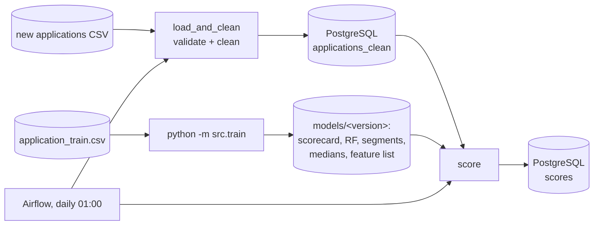

# Home Credit Default Risk: Scorecard, Risk Segments & Daily Batch Scoring

Credit-risk modeling on the Kaggle Home Credit data (307,511 applicants, 8.07% default rate), turned into a reproducible daily batch pipeline. The analysis started as a course project in IE 7275 (Data Mining in Engineering); the training scripts, batch scoring, Airflow pipeline, Docker setup and tests were added afterwards.

* **Competition:** [Home Credit Default Risk](https://www.kaggle.com/c/home-credit-default-risk)
* **Dataset:** [Kaggle Data Link](https://www.kaggle.com/c/home-credit-default-risk/data)

---

## What it does

1. **Trains** a bank-style scorecard (WOE binning, IV selection, logistic regression), a decision tree and a random forest, and segments applicants with K-Means on the forest's top features. Every model is evaluated on a stratified 20% hold-out and saved as a versioned bundle.
2. **Scores new applicants every day**: an Airflow DAG validates and cleans the day's applications, then writes each applicant's scorecard points, default probabilities, risk segment and the model version to PostgreSQL. Both steps are idempotent per run date, so retries and backfills never duplicate rows.

The Kaggle `application_test.csv` (48,744 applicants, no labels) stands in for a day's new applications.

## Architecture



Training is a manual step; the daily DAG only uses the current bundle (`models/LATEST`).

## Results (stratified 20% hold-out, 61,503 applicants)

| Model | Features | ROC-AUC | Gini | KS | Recall | F1 |
| :--- | :--- | :---: | :---: | :---: | :---: | :---: |
| Logistic scorecard (A) | 31 WOE variables | 0.7309 | 0.4618 | 0.3397 | 0.6693 | 0.2454 |
| Decision tree (B) | 185 encoded | 0.7170 | 0.4340 | 0.3252 | 0.6471 | 0.2415 |
| Random forest (B) | 185 encoded | 0.7346 | 0.4692 | 0.3496 | 0.6222 | 0.2609 |

- **The scorecard and the random forest are close** (AUC 0.7309 vs. 0.7346). The scorecard is the primary model: every point it assigns can be explained bin by bin, which lending decisions require.
- Recall and F1 use a 0.5 cut-off on models trained with balanced class weights, so the probabilities are not calibrated default rates.
- Train-vs-test PSI is near zero for every model, as expected for a random split of the same population; it is a sanity check, not evidence of robustness to drift over time.

### Risk segments (K-Means, K = 5, on the forest's top 15 features)

| Risk rank | Default rate (train) | Default rate (hold-out) | Applicants (train) | vs. average |
| :---: | :---: | :---: | :---: | :---: |
| 1 | 13.77% | 13.98% | 71,903 | 1.71× |
| 2 | 6.04% | 5.74% | 46,372 | 0.75× |
| 3 | 5.85% | 5.94% | 68,235 | 0.72× |
| 4 | 5.67% | 5.42% | 38,647 | 0.70× |
| 5 | 4.69% | 5.11% | 20,851 | 0.58× |

The highest-risk segment defaults at **13.77%**, 1.71× the average, and holds up on the hold-out (13.98%). The segments are a risk-stratification tool, not natural clusters: the silhouette score is 0.15.

## Fixes compared with the original course notebook

- The applicant ID (`SK_ID_CURR`) is excluded from the features; the original tree models used it as a feature.
- Missing values are filled with medians learned once on the training set; the original cleaning script computed a different median for every 2,000-row chunk.
- The pipeline now scores new applicants with saved models. Previously it only loaded predictions computed in a notebook on the training data itself.
- The features come from the main application table only (one-hot encoded to 185 columns); the bureau and previous-application tables are not used yet.

Because of the first two fixes, the numbers above differ slightly from the course report (forest AUC 0.7342, scorecard 0.7309, top segment 13.77%).

## Run it locally

Requirements: Docker Desktop, Python 3.11 for training, and the Kaggle CSVs.

```bash
pip install -r requirements.txt
cp .env.example .env              # set DATA_DIR to the folder with the Kaggle CSVs
DATA_DIR=/path/to/home-credit-default-risk python -m src.train      # ~15 min, writes models/
docker compose up -d --build      # PostgreSQL + Airflow
docker compose exec airflow cat standalone_admin_password.txt
```

Open http://localhost:8080 (user `admin`), unpause `credit_risk_pipeline` and trigger it. Check the results:

```bash
docker compose exec postgres psql -U pipeline_user -d homecredit \
  -c "SELECT segment_risk_rank, COUNT(*), ROUND(AVG(scorecard_pd)::numeric, 3) FROM scores GROUP BY 1 ORDER BY 1;"
```

Without a database, `python -m src.score score` writes `reports/scores_<date>.csv` instead.

## Tests

```bash
python -m pytest -q
```

The tests use small synthetic data (no download needed) and cover cleaning, input validation, feature alignment for unseen or missing categories, the ID never becoming a feature, training, scoring output, and idempotent re-runs. They run on every push through GitHub Actions.

## Project structure

```
├── src/
│   ├── config.py        paths and DATABASE_URL from environment variables
│   ├── clean.py         input validation and row-wise cleaning
│   ├── features.py      median imputation, one-hot encoding, column alignment
│   ├── train.py         scorecard, trees, segments, hold-out metrics, versioned bundle
│   └── score.py         daily load + score, idempotent writes to PostgreSQL
├── dags/credit_pipeline.py   Airflow DAG: load_and_clean >> score
├── tests/                    pytest on synthetic data
├── notebook/
│   ├── credit_risk_analysis.ipynb   original course analysis (EDA, Pipeline A vs. B)
│   └── model_output.ipynb           original model export
├── reports/metrics.json      metrics of the current model bundle
├── docker-compose.yml, Dockerfile, .env.example
└── requirements.txt
```

## Modeling approach

**Pipeline A: scorecard.** WOE binning of every variable (missing values get their own bin), IV filter (IV > 0.1 keeps 31 variables), logistic regression with balanced class weights, scaled to points (600 points at 1:11 odds, 50 points to double the odds).

**Pipeline B: trees and segments.** Median imputation and one-hot encoding (185 columns), a depth-6 decision tree and a 100-tree random forest (depth 10). The forest's 15 most important features are standardized and clustered with K-Means (K = 5); segments are ranked by their training default rate.
